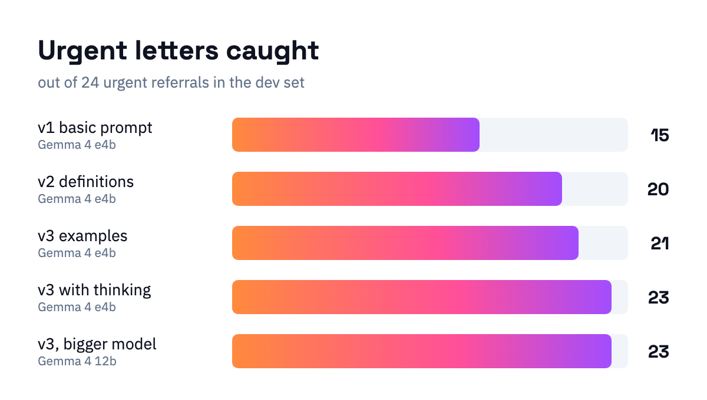

# referral-triage-evals

An LLM that sorts GP referral letters by specialty and urgency, and the eval that decides how far it can be trusted.


Write-up: [Classifying referrals with an LLM, and testing whether it works](https://www.danielruffolo.net/posts/2026-11-22-classifying-referrals-with-an-llm-evals/)



## Results

Every number comes from a real run of Gemma 4 through Ollama on a 16 GB Mac mini. All 240 letters are synthetic.

| Setup | Letters | Both labels right | Urgent caught | Triage cost |
| --- | --- | --- | --- | --- |
| v1 basic prompt, e4b | 120 tuning | 82% | 15 of 24 | 52 |
| v3 definitions and examples, e4b | 120 tuning | 87% | 21 of 24 | 35 |
| v3, 12b | 120 tuning | 92% | 23 of 24 | 14 |
| v3, 12b | 60 held out | 87% | 11 of 12 | 9 |
| v4 time-critical fix, 12b | 120 tuning | 95% | 24 of 24 | 8 |
| v4 time-critical fix, 12b | 30 new held out | 77% | 12 of 13 | 9 |

Triage cost weights each urgency mistake by its harm (lower is better). Answering "routine" to every letter scores 348.

To check any of these numbers without a model, run `python3 report.py`. It rebuilds every table in the article from the saved runs in `results/`.

What the eval showed:

- Defining the urgency categories in the prompt did the most, cutting missed urgent letters from 9 to 4.
- The 12b model matched the small model with reasoning on, in about a third of the time. Neither difference over v3 is proven at this sample size (better in 88% of bootstrap samples).
- The model's confidence is no use for deciding when a person should check. Its worst misses came with confidence of 0.95 and 1.0.
- It had a blind spot for injuries where surgery can't wait, such as Achilles ruptures. A two-line prompt change (v4) took the held-out catch rate on those cases from 4 of 13 to 12 of 13, with nothing that worked before breaking.

## Quick start

Python 3 standard library only. Works with any OpenAI-compatible endpoint; the default is Ollama on the same machine.

```bash
ollama pull gemma4:e4b
git clone https://github.com/devdaviddr/referral-triage-evals && cd referral-triage-evals

# classify one letter
echo "58yo smoker, 3 weeks of chest tightness walking uphill." | python3 classify.py

# score a prompt on the 120 tuning letters (about 5 minutes)
python3 evaluate.py --prompt v1 --set dev --workers 1

# compare saved runs without calling the model
python3 evaluate.py --compare results/dev-gemma4-e4b-v1.json results/dev-gemma4-12b-v4.json
```

| Setting | Default |
| --- | --- |
| `LLM_BASE_URL` | `http://127.0.0.1:11434/v1` |
| `LLM_MODEL` | `gemma4:e4b` |
| `LLM_API_KEY` | none |

## How it works

1. `classify.py` sends a letter and a prompt to the model and checks the JSON reply: a specialty, an urgency, a confidence and a reason. Replies with unknown labels are rejected, not guessed.
2. `evaluate.py` runs a labelled set, scores it and saves every answer to `results/`, so runs can be compared later without the model.
3. `bootstrap.py` resamples the letters 5,000 times to show how much of a difference between two runs could be chance.
4. `labelcheck.py` has a second model label every letter blind, as a check on the answer key.

Each run reports specialty and urgency accuracy, precision and recall per label, urgent letters missed or sent to routine, the triage cost, time per letter, and a sweep of what happens if letters below a confidence bar go to a person.

## Reproduce the article

```bash
ollama pull gemma4:e4b && ollama pull gemma4:12b
./run_all.sh                                   # about 2.5 hours, most of it the reasoning run
ollama pull qwen3.5:9b
LLM_MODEL=qwen3.5:9b python3 labelcheck.py     # about 15 minutes
```

Runs use temperature 0, so they should match the saved results closely, though not always exactly across machines and Ollama versions.

## Tests

```bash
python3 -m unittest discover -s tests
```

Offline tests for reply parsing, the scoring maths, the confidence sweep and the bootstrap. No model needed.

## Repository layout

```text
classify.py          one letter in, labels out
evaluate.py          score a labelled set, save and compare runs
bootstrap.py         how much of a difference could be chance
labelcheck.py        blind second-model check of the answer key
report.py            rebuild the published tables from results/
run_all.sh           every eval behind the article
run_followup.sh      the v4 follow-up runs
prompts/             v1 to v4, plus the label-check prompt
data/                240 synthetic letters (see data/README.md)
results/             every run behind the published numbers
tests/               offline unit tests
docs/                chart used in this README
```

## Limits

- The letters are synthetic, and no clinician reviewed the labels. A second model checked them instead ([data/README.md](data/README.md)).
- The samples are small: 24 urgent letters in the tuning set, so one letter moves the catch rate by four points.
- Only Gemma 4 was tested, on one machine.

## What I'd do next

- Real, de-identified referrals labelled by two clinicians each, to measure how often experts agree.
- Hundreds of urgent cases, so small differences become measurable.
- The same eval on a large hosted model as a ceiling, and on other open models.
- A better signal for when to ask a person, such as asking the model three times and flagging disagreements.
- A check on the reason behind each label, not just the label.

## Licence

MIT. See [LICENSE](LICENSE).
